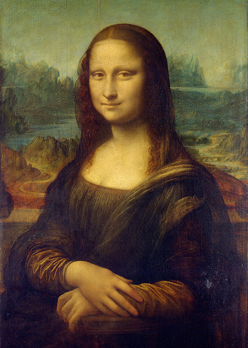

# xche0450_9103_groupB

## IDEA9103 Creative Coding

This repository belongs to **xche0450** from *Group B*.

### Repository contents

- Course: IDEA9103 Creative Coding
- Tutorial group: Group B
- Main project folder: `assignment`

### Useful link

[University of Sydney Canvas](https://canvas.sydney.edu.au/)

### README image practice

> This README was prepared as part of the GitHub Extra Lesson.

### Lesson checklist

1. Set up the repository.
2. Practise Markdown formatting.
3. Add the p5.js project later.
